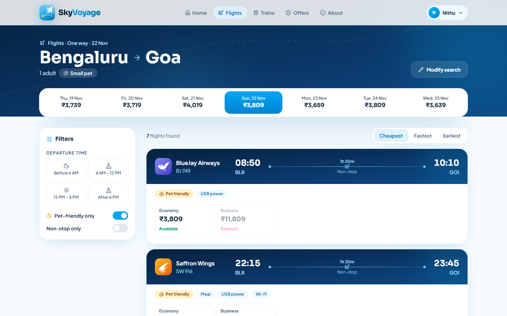
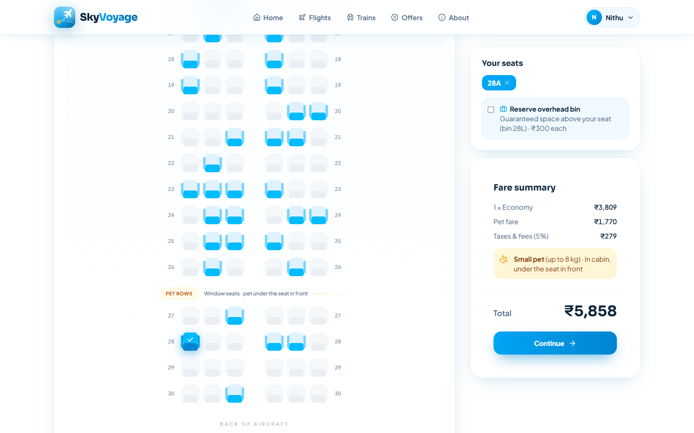
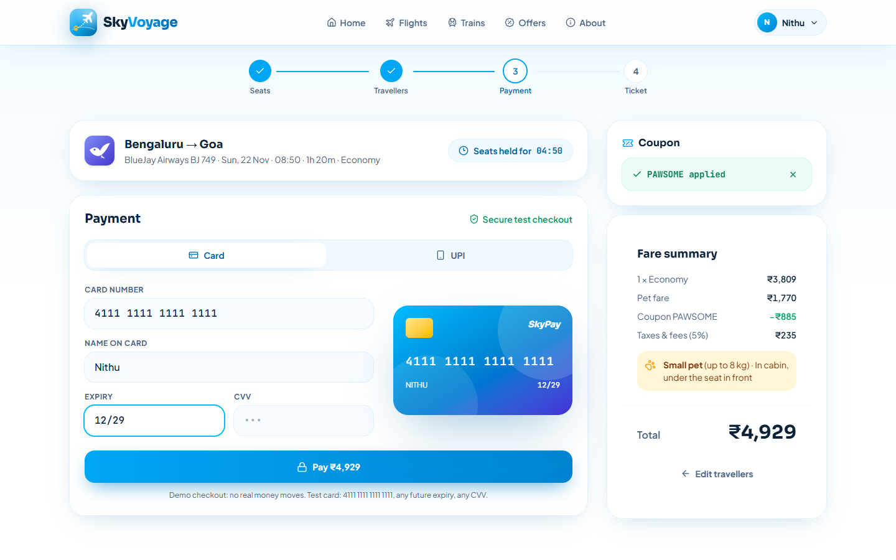
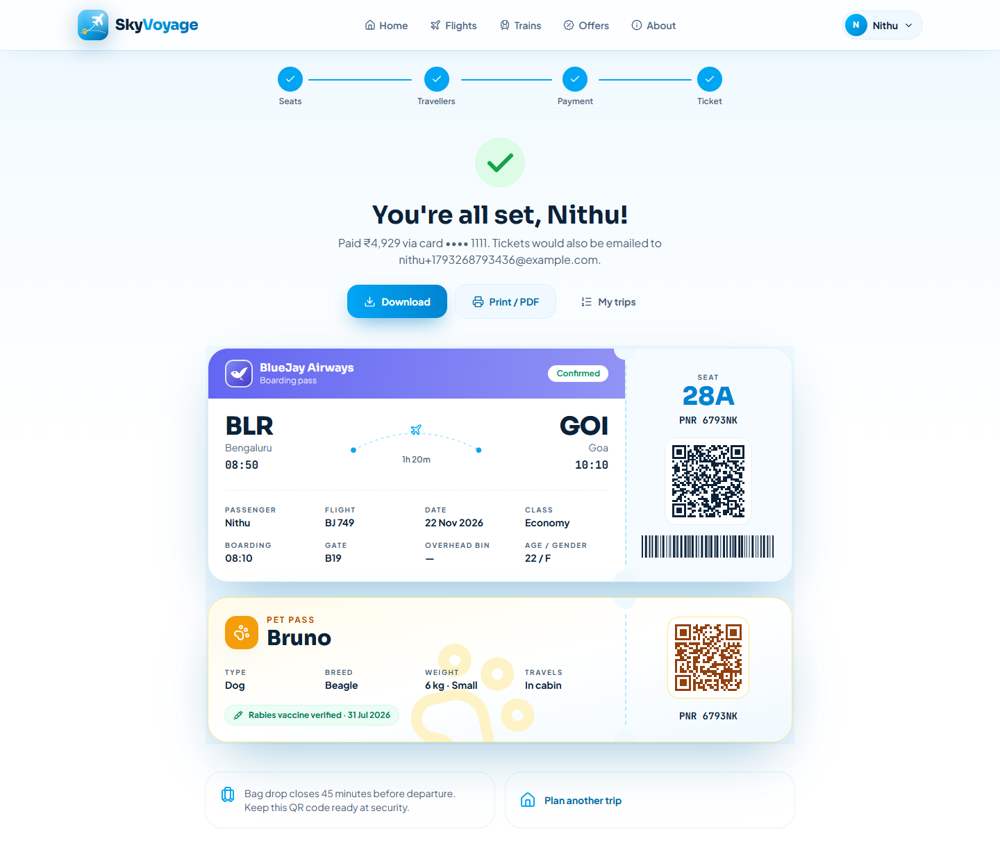
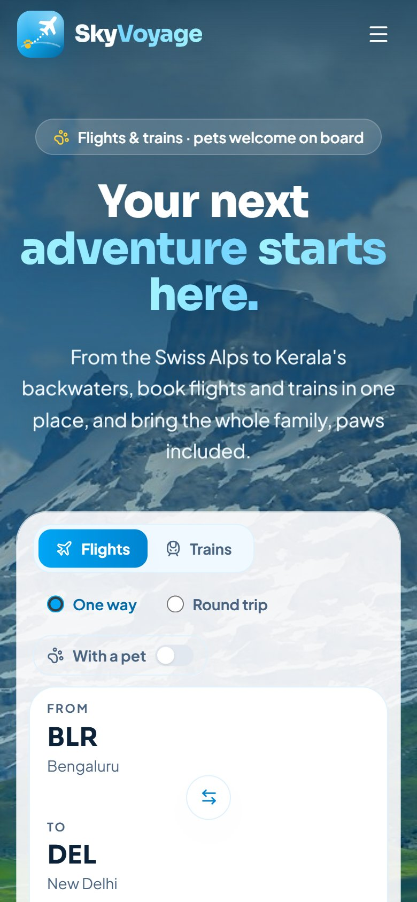

# SkyVoyage — Smart Travel Booking with Pet Support

Flight and train booking where pets are first-class travellers: pet rows on flights, a pet coach on trains with whole-party cabin allocation, vaccination checks and a pet pass with every ticket.

## Screenshots


| Search results | Seat map with pet rows |
|---|---|
|  |  |
| **Payment with coupon** | **E-ticket and pet pass** |
|  |  |

<p align="center"></p>

| Layer | Tech |
|---|---|
| Frontend | React 19, TypeScript, Vite, Tailwind CSS v4, Framer Motion, Zustand, React Router |
| Backend | Node.js, Express 5, TypeScript, Zod |
| Data | PostgreSQL 16 (Prisma ORM), Redis 7 (seat holds) |
| Auth | bcrypt, JWT access tokens, rotating refresh tokens in httpOnly cookies, role-based access |
| Tests | Vitest + Supertest integration tests against a real test database |
| Infra | Docker Compose |

```
webdev-main/
├── frontend/   React app (see frontend/README.md)
├── backend/    REST API
├── shared/     Pricing, seat layouts, coupon and booking rules used by BOTH apps
├── loadtest/   k6 load test and results
├── docs/       Screenshots
└── docker-compose.yml   PostgreSQL + Redis
```

This is a rebuild of a 2024 PHP/MySQL version of the project; its seat-hold (`reserved_until`), Tatkal and waitlist logic carried over into the new backend.

## Run it locally

Needs Node 20+ and Docker Desktop.

```bash
docker compose up -d                 # PostgreSQL + Redis

cd backend
cp .env.example .env                 # then set long random JWT secrets
npm install
npx prisma migrate deploy            # create the tables
npm run dev                          # API on http://localhost:4000

cd ../frontend                       # in a second terminal
npm install
npm run dev                          # app on http://localhost:5173 (proxies /api to the backend)
```

- Register at `/register`. The account whose email matches `ADMIN_EMAIL` in `.env` becomes an admin and can open `/admin`.
- Test card: `4111 1111 1111 1111`, any future expiry, any CVV.
## Testing

| Layer | Tool | Command | Covers |
|---|---|---|---|
| API integration | Vitest + Supertest | `cd backend && npm test` | 16 tests: auth and refresh-token rotation, seat-hold races, idempotent payments, rule validation, waitlist promotion, seat layouts (separate `skyvoyage_test` database) |
| End to end | Playwright (installed Chrome) | `cd frontend && npm run test:e2e` | 3 browser tests: full booking to e-ticket, a held seat blocked for another user, login-protected pages. Needs the backend running. |
| Load | k6 (via Docker) | see `loadtest/README.md` | 100 browsing + 30 booking users and a 50-user same-seat race; before/after results included |

## How the important parts work

**No double booking, enforced in two layers**
1. *Redis seat hold.* When you continue from the seat map, `POST /api/holds` runs a Lua script that sets one key per seat (`hold:<trip>:<seat>`) only if none of them is held by someone else, all in one atomic step, with a 5-minute expiry (`PX`). Abandoned checkouts free themselves; no cleanup job.
2. *Database constraint.* `SeatAssignment` has `UNIQUE(tripId, seatId)`. The booking transaction also locks the trip's inventory row with `SELECT … FOR UPDATE`, so waitlist numbers and Tatkal counts never race. Even if Redis were bypassed, the database refuses a second sale (HTTP 409).

A test fires 20 simultaneous holds at one seat and asserts exactly one wins.

**Server is the source of truth for money.** Pricing lives in `shared/pricing.ts`. The browser uses it to show the price; the server recomputes it from scratch and never trusts a client total.

**Idempotent payments.** Each checkout sends an `Idempotency-Key`. A retry (double click, flaky network) returns the original booking instead of charging twice; `Payment.idempotencyKey` is unique.

**Waitlist promotion.** Cancelling a booking deletes its seat rows and, in the same transaction, gives the freed seats to the oldest waitlisted bookings on that trip and class that fit (the PHP `handle_cancellation()` logic, now transactional).

**Pet allocation.** On trains the party and pet must share one 4-berth cabin. "Best cabin for my party" uses best-fit: the cabin with the fewest spare berths that still fits, keeping empty cabins free for larger families. Small pets on flights require a traveller in a pet row.

**Auth.** Passwords are hashed with bcrypt (12 rounds). Short-lived access JWTs (15 min) are kept in memory only. The refresh token is an httpOnly cookie, stored as a SHA-256 hash and rotated on every use. If an old refresh token is ever reused, all of that user's sessions are revoked (theft detection). Login is rate-limited and returns the same error for unknown email and wrong password.

## Database (9 tables)

`User`, `RefreshToken`, `Booking`, `BookingLeg`, `Passenger`, `Pet`, `SeatAssignment`, `Payment`, `TripInventory`. Timetables are generated deterministically from route + date (same search, same results), so they aren't stored; everything a booking creates or changes is.

## API

| Method | Path | |
|---|---|---|
| POST | `/api/auth/register` · `/login` · `/refresh` · `/logout` | Session |
| GET | `/api/auth/me` | Current user |
| GET | `/api/trips/search?mode&from&to&date` | Trips with live availability |
| GET | `/api/trips/:id/seats?cls` | Seats sold or held by others |
| POST / DELETE | `/api/holds` · `/api/holds/:id` | 5-minute seat hold |
| POST | `/api/bookings` (Idempotency-Key) | Book and pay |
| GET | `/api/bookings` · `/api/bookings/:pnr` | My bookings |
| POST | `/api/bookings/:pnr/cancel` | Cancel, refund, promote waitlist |
| GET | `/api/pnr/:pnr` | Public PNR status (no personal data) |
| GET | `/api/offers` | Coupons |
| GET | `/api/admin/stats` | Admin only |
